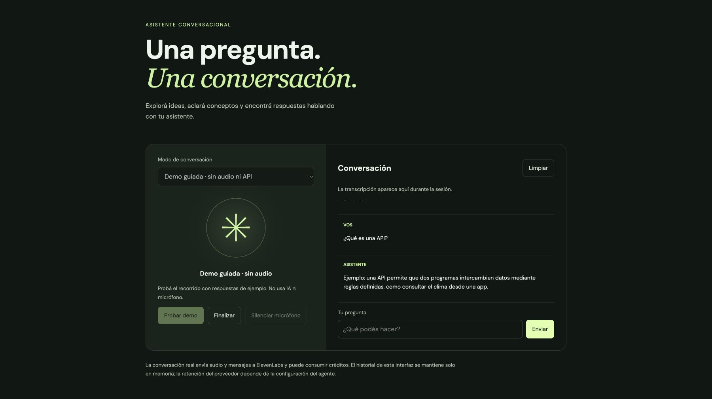

# Voz · Asistente general

Asistente de preguntas y respuestas con voz, transcripción y controles de sesión. Proyecto personal de Felipe Heredia, con JavaScript, ElevenLabs Agents y una API Node/Express.



## Estado

MVP local. Demo guiada funcional sin credenciales ni micrófono. Integración real implementada con el SDK oficial, **pendiente de validación con una cuenta y agente de ElevenLabs**. No se presenta como una conversación real ya probada.

## Ejecutar

Node >=22.22. Dos terminales:

```sh
npm ci
cp .env.example .env
npm run server
```

```sh
npm run dev
```

Abrir http://127.0.0.1:5190. La demo permite probar inicio, mensajes, transcripción, limpieza y cierre sin enviar datos a ElevenLabs. Sus respuestas son predefinidas y están etiquetadas como ejemplos.

## Activar la conversación real

1. Crear un agente en ElevenLabs, elegir español y una voz, y cargar el texto sugerido en `docs/agent-prompt.txt`. No requiere herramientas externas ni datos personales.
2. Activar autenticación del agente. Configurar los eventos de transcripción y respuesta necesarios para `onMessage` según el dashboard del proveedor.
3. Completar `ELEVENLABS_API_KEY` y `ELEVENLABS_AGENT_ID` en `.env` y reiniciar el servidor. Nunca usar una variable `VITE_` para la clave.
4. Elegir el modo real y pulsar Iniciar conversación. El navegador solicitará permiso para el micrófono. Es necesario disponer de créditos/cuota en ElevenLabs.
5. Probar preguntas, silencio, mensajes escritos y Finalizar. Comprobar que el indicador del micrófono se apaga al terminar.

El backend pide una URL firmada de corta duración. El navegador conecta por WebSocket con el SDK de ElevenLabs. La clave nunca se envía al frontend. La sesión usa el modelo y voz configurados en el agente; no incluye búsqueda web ni acciones sobre otras aplicaciones.

## Datos y alcance de despliegue

La transcripción solo vive en la memoria de esta interfaz y desaparece al recargar; limpiar la interfaz no borra datos retenidos por el proveedor. Revisar la retención en ElevenLabs. No se guardan audios en este repositorio.

El servidor escucha únicamente en loopback y acepta el origen local definido, con límite de emisión de una URL cada 10 segundos. Es un MVP para una persona: **no publicar el endpoint sin autenticación, límites por usuario, HTTPS y control de consumo**. La protección de origen no sustituye autenticación para producción. Vite genera el frontend; el backend se ejecuta por separado.

## Validación

```sh
npm test
npm run build
```

Las pruebas del servidor usan un proveedor simulado: configuración ausente, origen rechazado, respuesta firmada, fallos sanitizados y respuesta inválida. No consumen créditos. La prueba de voz real queda pendiente de credenciales.

## Referencias

- [SDK JavaScript oficial](https://elevenlabs.io/docs/eleven-agents/libraries/java-script)
- [Autenticación de agentes](https://elevenlabs.io/docs/eleven-agents/customization/authentication)

## Próximos pasos

Validar voz real y reconexión en Chrome/Safari; medir latencia y documentar resultados; agregar pruebas de interfaz automatizadas; preparar autenticación antes de una demo pública.
